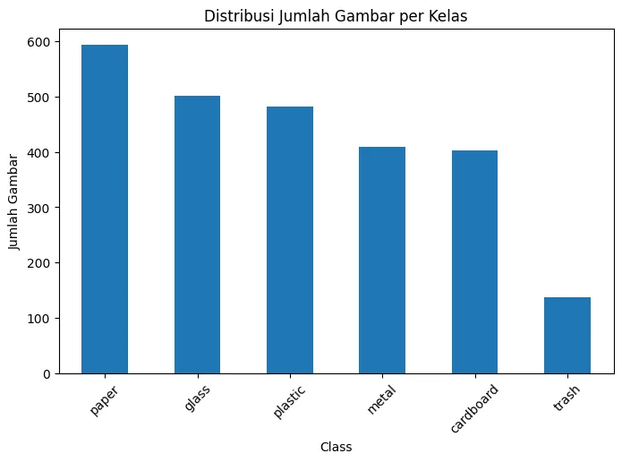
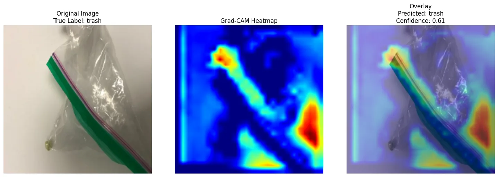

# Waste Material Image Classification — CNN & MobileNetV2 with Grad-CAM

**BINUS University | Team Deep Learning coursework | Computer Vision | Explainable AI**

This academic team project investigates image-based sorting of six types of waste—**cardboard, glass, metal, paper, plastic, trash**—from **2,527 labeled images**. Two custom CNN configurations and two MobileNetV2 transfer-learning variants were investigated, using separate train/validation/test subsets. Grad-CAM was used to inspect spatial attention on correct and incorrect predictions.

> **Best reported test accuracy: 81.32% (MobileNetV2 V1).** This is an archived experimental result, not a freshly retrained benchmark or evidence of a deployed recycling application. Different training budgets and test-based model comparison limit controlled performance claims.



## Data and processing

- Images (224 × 224 × 3) from class directories; labels are mapped to six categorical classes.
- Class counts: paper 594, glass 501, plastic 482, metal 410, cardboard 403, trash 137. This means the largest class has approximately 4.34 times the smallest class's examples.
- Stratified 70%/15%/15% split: **1,768 train / 379 validation / 380 test**.
- Pixel normalization `x/255`, one-hot targets, TensorFlow `tf.data` pipelines with caching/batching/prefetching.
- Train-time augmentations: horizontal flips, mild rotation, zoom, translation and contrast adjustments.
- Balanced class weights, with additional weight tuning for difficult glass and, in MobileNetV2 V2, trash examples.
- MobileNetV2 inputs are internally rescaled from `[0, 1]` to `[-1, 1]`, before the pretrained backbone.

## Model comparison

| Candidate | Test accuracy | Test precision* | Test recall* | Macro F1 | Weighted F1 |
|---|---:|---:|---:|---:|---:|
| Baseline CNN (3 convolutional blocks) | 54.74% | 73.94% | 36.58% | 0.55 | 0.55 |
| Improved CNN (4 blocks + BN + GAP) | 80.26% | **87.15%** | 73.16% | **0.80** | 0.80 |
| **MobileNetV2 V1** (pretrained + fine-tuned) | **81.32%** | 84.05% | **77.63%** | 0.78 | **0.81** |
| MobileNetV2 V2 (adjusted regularization/class weights) | 79.74% | 80.66% | 76.84% | 0.78 | 0.80 |

*Test precision and recall in the middle columns are the Keras `model.evaluate` metrics printed by the original notebooks; they are not macro-averaged one-vs-rest precision and recall. F1 comes from scikit-learn classification reports. The poster reports rounded metrics and may use a different F1 averaging convention.

**Why the results differ:** A small and imbalanced dataset makes some waste categories hard to distinguish. Improved CNN training benefits from Batch Normalization and Global Average Pooling, while pretrained MobileNetV2 adds general-purpose visual features. V1 performed best overall on the available test cohort; V2 raised **trash recall from 0.55 to 0.65** despite lower overall accuracy. The glass class improved from 0.33 baseline recall to 0.74 with the improved CNN, consistent with better modeling and targeted class-weight tuning, but no single change was experimentally isolated.

## Grad-CAM interpretability



Attention overlays can highlight visually relevant object regions; some wrong predictions also reveal sensitivity to backgrounds, lighting and object scale. Grad-CAM is a diagnostic aid, not proof the model identifies causal features.

## Files

```text
notebooks/
  01_baseline_and_improved_cnn.ipynb
  02_mobilenetv2_v1_v2_gradcam.ipynb
figures/
  eda/ · cnn/ · mobilenet/ · gradcam/
reports/
  cnn-baseline-improved-academic-report.pdf
data/README.md
EXPERIMENT_EVIDENCE.md
requirements.txt
```

- **Notebook 1:** Original team experiment for baseline and improved custom CNNs, including Grad-CAM.
- **Notebook 2:** MobileNetV2 V1 and V2 transfer-learning and error-analysis experiments.
- **Academic report:** Earlier phase documenting the first two CNN variants, not the full four-model study.
- **Poster:** Sanitized image with member identifying footer removed. The original poster is *not* distributed.
- **Dataset:** Local `trash_images` folder is not redistributed. Instructions in `data/README.md`.

## Reproducing

1. Install dependencies from `requirements.txt` into a compatible TensorFlow Python environment.
2. Place the six waste-category folders inside `trash_images/` at the repository root.
3. Run either notebook from the repository root. Both notebooks are standalone experimental work; notebook 2 is not a continuation of notebook 1's Python kernel.
4. Each notebook saves Keras checkpoints and Grad-CAM outputs locally. Those files are intentionally excluded from version control.

This repository preserves original code and previously recorded outputs. It does **not** claim a successful rerun or reproducibility without the original image dataset and environment.

## Credits and scope

Coursework was developed by a **five-person student team at BINUS University**, including the repository owner. No individual contribution breakdown is asserted because it is not documented in the provided files. The sanitized poster and academic report illustrate the team's project. This is a proof of concept; it has no verified deployment or measured recycling-impact result.

For reproducibility caveats, see [EXPERIMENT_EVIDENCE.md](EXPERIMENT_EVIDENCE.md).
